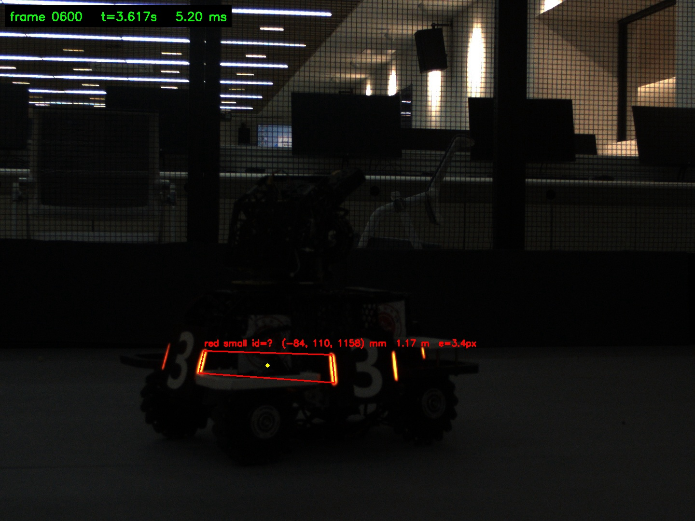

# 2027 赛季征途 Uprising 视觉组考核（自瞄方向）

基于给定视频、相机标定与 IMU 数据，完成装甲板检测、PnP 位姿估计，
并输出带检测结果和耗时的演示视频与逐帧数据。

> 本仓库的工程位于 `26机器人罗云祺/` 子目录，以下命令默认先 `cd 26机器人罗云祺`。

## 1. 环境

- Ubuntu 22.04
- CMake ≥ 3.16
- OpenCV 4.5（core / imgproc / videoio / highgui / calib3d）
- C++17

```bash
sudo apt install build-essential cmake libopencv-dev
```

## 2. 编译

```bash
cd 26机器人罗云祺
cmake -S . -B build -DCMAKE_BUILD_TYPE=Release
cmake --build build -j
```

## 3. 数据

战队提供两段考核视频，解压到工程目录下：

```
26机器人罗云祺/
└── data/
    ├── 18-25/    # 2026-11-13_18-25-25_462305，1770 帧
    └── 18-28/    # 2026-11-13_18-28-12_830451，1240 帧
```

每段包含 `calibration/ imu/ video/ metadata.json`，约 600 MB，不随仓库提交。

代码实际读取：

| 文件 | 用途 |
|---|---|
| `calibration/calibration.yaml` | 内参 K、畸变 D、相机→云台外参（米） |
| `video/video.avi` | 1440×1080 MJPG，约 166 fps |
| `video/frames.csv` | 逐帧时间戳（主机单调时钟纳秒） |
| `imu/frame_imu.csv` | 逐帧四元数（当前仅加载，未参与解算） |

时间戳以 `frames.csv` 为准，不使用 `VideoCapture` 的 PTS。

## 4. 运行

```bash
cd 26机器人罗云祺

# 18-25 段
./build/rm_autoaim --config config/autoaim.yaml --headless --out output/18-25

# 18-28 段
./build/rm_autoaim --config config/autoaim.yaml \
  --dataset data/18-28 --headless --out output/18-28
```

输出：

- `output/18-25/demo.mp4`、`output/18-28/demo.mp4`：30 fps 抽帧结果视频
- `output/18-25/result.csv`、`output/18-28/result.csv`：逐帧/逐板结果
- `--dump 600` 可额外保存单帧标注图

CSV 列：

```
frame, timestamp_ns, elapsed_s, valid, color, number,
x_m, y_m, z_m, distance_m, reproj_px, frame_ms
```

## 5. 方法

### 5.1 检测

1. 灰度化，固定阈值 150 二值化；
2. `findContours` 取外轮廓，`minAreaRect` 拟合灯条；
3. 灯条过滤：面积 ≥ 100 px²、长宽比 1.5–20、与竖直方向夹角 ≤ 45°；
4. 颜色判定：用 R−G / B−G 通道差区分红蓝，白/蓝白背景判为未知并丢弃；
5. 左右配对：两灯条长度差 ≤ 40 px、y 中心差 ≤ 40 px、中心距 60–800 px、
   灯条与中心连线的垂直度误差 ≤ 25°、颜色一致；
6. 去重：共用同一灯条的两块板，保留外接矩形面积大的；
7. 最小宽度 60 px，滤掉远处灯带/反光拼出的假板。

### 5.2 PnP

1. 四个角点用 `undistortPoints(..., K, D, noArray(), K)` 去畸变；
2. 3D 点取 135 mm × 56 mm，原点在板中心，单位米；
3. `solvePnPGeneric(SOLVEPNP_IPPE)`，平面目标返回两组解；
4. 选解：`z > 0`、板法向与平移同向（`n·t > 0`）、四角重投影误差最小；
5. `solvePnPRefineLM` 精化；
6. 误差取四角平均重投影误差（像素）。

## 6. 结果

| 数据 | 有检测帧 | 目标距离 | 重投影误差 | 检测 + PnP 耗时 |
|---|---|---|---|---|
| 18-25（1770 帧） | 1701（96.1%） | 1.04–2.17 m | 3.38 px | 2.37 ms（P95 3.27） |
| 18-28（1240 帧） | 1240（100%） | 1.72–1.89 m | 3.39 px | 3.22 ms |

18-25 另有 1 帧误检到 5.14 m（远处灯带），已列为已知问题。



完整结果见 `results/18-25/`、`results/18-28/` 下的 `demo.mp4` 与 `result.csv`。

## 7. 已知限制

- 目标转到侧面、正面装甲接近 90° 时，两根灯条几乎重合，18-25 段约 69 帧漏检；
- 蓝方没有样本，红蓝分支中的蓝色未实测；
- 大装甲板 230 × 56 未验证；
- 未实现数字识别与跟踪补帧（`Tracker` 已有接口，未接入主流程）。

## 8. 目录结构

```
26机器人罗云祺/
├── CMakeLists.txt
├── config/autoaim.yaml
├── include/rm/          # 接口
├── src/                 # 实现
├── docs/                # 说明与结果图
├── results/             # 两段数据的 demo.mp4、result.csv
└── README.md
```

## 9. 参考与 AI 说明

- 参考 [sp_vision_25](https://github.com/TongjiSuperPower/sp_vision_25) 的算法思路，未复制代码；
- 工程骨架（CMake、配置/标定/数据读取、可视化、耗时统计）与初版检测/PnP 由 AI 辅助生成；
- 本人在此基础上逐行理解、调整参数，并在两段数据上复现和验证了全部指标；
- 参考 OpenCV 官方文档：`solvePnPGeneric`、`SOLVEPNP_IPPE`、`solvePnPRefineLM`、`undistortPoints`。
