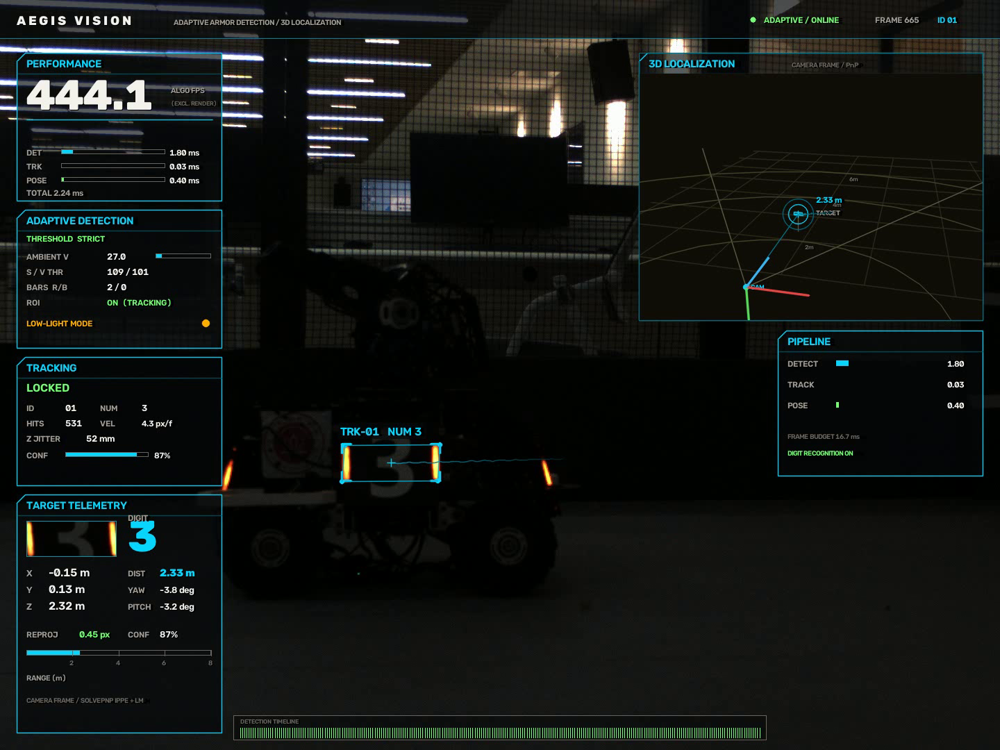
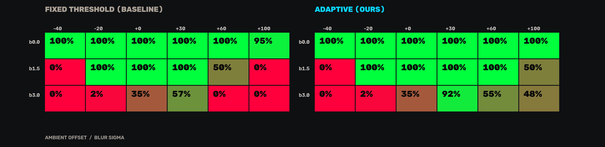
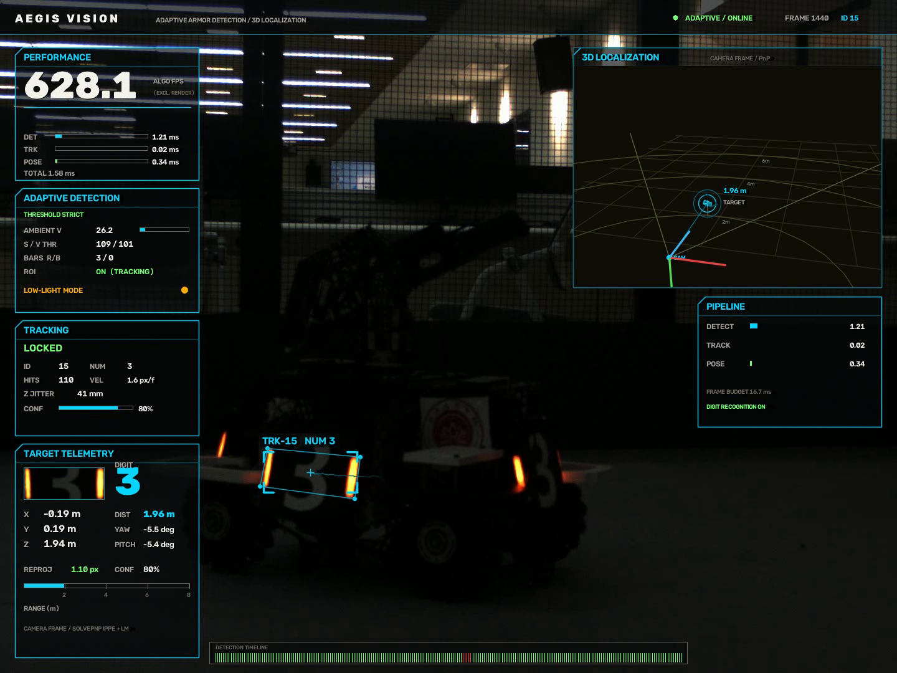
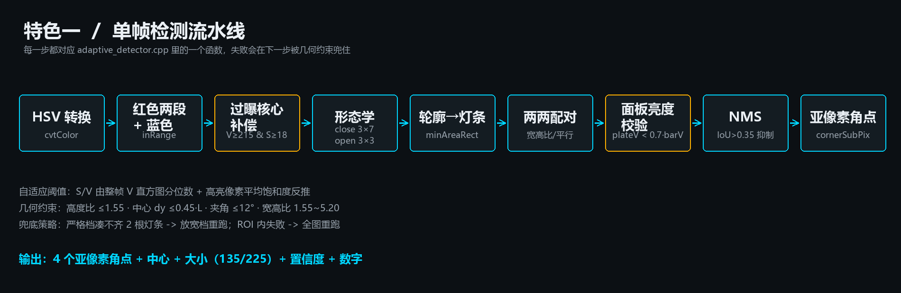

# Aegis Vision

**RoboMaster 2027 赛季征途 Uprising · 视觉组考核（自瞄方向）**

| 项目 | 内容 |
|------|------|
| 提交人 | 26 级 广告学 丁栩安 |
| 目标环境 | Ubuntu 22.04 · C++17 · OpenCV 4.5.4 · CMake 3.22 |
| 输入 | 战队考核数据包 `2026-11-13_18-28-12_830451`、`2026-11-13_18-25-25_462305` |
| 输出 | 带 HUD 的演示视频（`.mp4`）+ 逐帧结果（`.csv`） |
| 演示 | [第一段 13.5 s](demo/AegisVision_demo.mp4) · [第二段 16.7 s](demo/AegisVision_demo_take2.mp4) |

一套完整的传统视觉自瞄前端：**灯条检测 → 两两配对 → 四角点/中心 → PnP 三维定位 → 卡尔曼跟踪 → 数字识别 → HUD 可视化**。
不依赖深度学习模型和 GPU，在 Ubuntu 22.04 + OpenCV 4.5.4 上即可编译运行。



---

## 1. 结果速览

| 指标 | 第一段 `830451`（1240 帧） | 第二段 `462305`（1770 帧） |
|------|---------------------------|---------------------------|
| 检测率（第 150 帧起，目标完整入画） | **100.00%**（1090/1090） | **97.47%**（1579/1620） |
| 检测率（全段，含目标被裁切的帧） | 97.34%（1207/1240） | 97.57%（1727/1770） |
| 数字识别输出 `3`（第 150 帧起） | **100.00%**（1090/1090） | 85.31%（1382/1620） |
| 单帧总耗时（中位 / 均值） | **1.25 / 1.61 ms** | **1.40 / 2.78 ms** |
| 其中检测耗时（中位） | 0.99 ms | 1.13 ms |
| 算法吞吐（1000 / 均值耗时） | 约 620 fps | 约 360 fps |
| PnP 重投影误差（中位 / P95，第 150 帧起） | **0.43 / 1.60 px** | 1.45 / 5.38 px |
| 深度 Z（均值 / 标准差，第 150 帧起） | 2.43 / 0.171 m | 1.98 / 0.267 m |
| 轨迹 ID 切换 | 0 次 | 9 次（两板交替） |

> 数据取自 `results/first_run.csv` 与 `results/second_run.csv`，由本仓库代码在同一台机器上实际跑出。
> 测试平台：i9-14900HX / OpenCV 5.0 / Release / 1440×1080；同一台机器多次运行耗时有 ±10% 波动。
> 第一段前 150 帧目标被画面左边界裁掉一半，主表从第 150 帧开始统计（全段数值另列，供参考）。
> 第二段的 9 次 ID 切换发生在两块装甲板同时可见、主目标在两板间切换时，属于已知限制，见第 10 节。

### 消融：四个配置（同一段视频、同一天连续运行）

| 配置 | 检测率（第 150 帧起） | 中位耗时 | 说明 |
|------|----------------------|----------|------|
| A. 固定阈值 + 无过曝补偿（教科书写法） | 0.00%（0/1090） | 8.24 ms | 灯芯全白，灯条变空心轮廓，配不成对 |
| B. 固定阈值 + 过曝补偿 | 100.00% | 12.52 ms | 补偿有效，但阈值不随光照变化 |
| C. 自适应阈值 + 补偿 + 全图搜索 | 100.00% | 12.73 ms | 本方案去掉 ROI 的版本 |
| D. 自适应 + 补偿 + 跟踪 ROI + 数字识别（本方案） | **100.00%** | **1.25 ms** | 相对 C 约 **10.2×** 加速 |

### 消融：环境光 × 运动模糊（40 帧真实画面 × 18 组扰动）



* 横轴为整帧叠加的环境光偏移（−40 ~ +100 灰度），纵轴为高斯模糊 σ（0 / 1.5 / 3.0）。
* 强光 + 模糊时差距最大：`+60 / σ=1.5` 时自适应 **100%**、固定阈值 **50%**；`+30 / σ=3.0` 时 **92.5% vs 57.5%**；
  `+100 / σ=1.5` 时 **50% vs 0%**。原因是强光把灯条中心洗白，自适应会按高亮像素饱和度主动降 S。
* 数据在 `results/sweep.csv`，由 `src/sweep.cpp` 生成。

第二段两板同时可见、目标大偏航时的实际画面（ID 15、Z≈1.94 m、重投影 1.10 px）：



---

## 2. 环境与依赖

### 2.1 目标环境

| 项目 | 版本 / 说明 |
|------|-------------|
| 操作系统 | Ubuntu 22.04 LTS（考核要求） |
| 编译器 | g++ 11.4.0（Ubuntu 22.04 默认），C++17 |
| 构建工具 | CMake ≥ 3.16（22.04 自带 3.22.1） |
| 视觉库 | OpenCV ≥ 4.5.4（22.04 `libopencv-dev` 即 4.5.4） |
| 其他依赖 | 无。不需要 CUDA、PyTorch、TensorRT 或任何模型权重 |
| 模型文件 | **本方案不使用深度学习模型，无权重文件**；数字识别模板由代码内生成 |

### 2.2 安装依赖

```bash
sudo apt update
sudo apt install -y build-essential cmake libopencv-dev
```

确认版本：

```bash
g++ --version          # g++ (Ubuntu 11.4.0-1ubuntu1~22.04) 11.4.0
cmake --version        # cmake version 3.22.1
pkg-config --modversion opencv4   # 4.5.4
```

> OpenCV 5.0 把 `findContours`、`minAreaRect`、`fitLine` 等 2D 几何函数从 `imgproc` 移到了新的 `geometry` 模块。
> `include/aegis/compat.hpp` 用 `__has_include` 自动适配头文件，因此同一份源码在 OpenCV 4.5.4 与 5.0 下都能编译；
> 代码本身只使用 C++17 标准库与 OpenCV 通用接口，没有平台相关 API。
> 本机调试使用 OpenCV 5.0，Ubuntu 22.04 的构建/运行步骤即下面第 4、5 节。

### 2.3 数据与相机参数

两段考核视频合计约 1.1 GB，**不放进仓库**（`.gitignore` 已忽略 `data/`）。使用时把战队给的两个 ZIP 解压到 `data/`：

```bash
mkdir -p data
unzip 2026-11-13_18-28-12_830451.zip -d data/
unzip 2026-11-13_18-25-25_462305.zip -d data/
```

解压后目录结构：

```
data/
├── 2026-11-13_18-28-12_830451/
│   ├── video/video.avi          # 1440×1080 @ 165.93 fps，1240 帧
│   ├── video/frames.csv
│   ├── calibration/intrinsics.yaml
│   ├── calibration/handeye.yaml
│   ├── imu/frame_imu.csv
│   └── metadata.json
└── 2026-11-13_18-25-25_462305/  # 1770 帧，结构同上
```

**相机参数如何使用**：`config/aegis.yaml` 里的内参、畸变、手眼矩阵直接抄自数据包
`calibration/intrinsics.yaml` 与 `handeye.yaml`。两份数据包的这两个文件**逐字节相同**（MD5 一致），
所以同一份配置对两段视频都成立。原始标定文件副本放在 `config/calib/830451/` 与 `config/calib/462305/`，方便对照：

| `config/aegis.yaml` 字段 | 来源 |
|--------------------------|------|
| `camera.camera_matrix` | `calibration/intrinsics.yaml` → `camera_matrix` |
| `camera.distort_coeffs` | `calibration/intrinsics.yaml` → `distort_coeffs` |
| `camera.R_camera2gimbal` | `calibration/handeye.yaml` → `R_camera2gimbal` |
| `camera.t_camera2gimbal` | `calibration/handeye.yaml` → `t_camera2gimbal` |
| `armor.small_width_m` / `large_width_m` | 考核文档：小 135 mm、大 225 mm |
| `armor.height_m` | 灯条长度 0.055 m（代码里 135:55 ≈ 2.45 的宽高比判定与之一致；文档标称 56 mm，差 1 mm，对 Z 的影响约 1.8%）|

> 换相机或换标定时，只改 `config/aegis.yaml` 的 `camera` 四个字段即可，不需要重新编译。

---

## 3. 构建

```bash
cmake -S . -B build -DCMAKE_BUILD_TYPE=Release
cmake --build build -j$(nproc)
```

产物：`build/aegis`。查看参数：

```bash
./build/aegis --help
```

可选：编译开发期勘察工具（`probe`、`sweep`、`vframe` 等，默认关闭）

```bash
cmake -S . -B build -DCMAKE_BUILD_TYPE=Release -DAEGIS_BUILD_TOOLS=ON
cmake --build build -j$(nproc)
```

---

## 4. 运行（两段考核视频的完整命令）

**第一段** `18-28-12_830451`：

```bash
./build/aegis --config config/aegis.yaml \
              --video data/2026-11-13_18-28-12_830451/video/video.avi \
              --out demo/AegisVision_demo.mp4 \
              --csv results/first_run.csv
```

**第二段** `18-25-25_462305`：

```bash
./build/aegis --config config/aegis.yaml \
              --video data/2026-11-13_18-25-25_462305/video/video.avi \
              --out demo/AegisVision_demo_take2.mp4 \
              --csv results/second_run.csv
```

或者一条命令跑两段（脚本会自动检查数据是否就位）：

```bash
bash scripts/run_both.sh data
```

### 4.1 参数含义

| 参数 | 默认值 | 必填 | 说明 |
|------|--------|------|------|
| `--config <yaml>` | `config/aegis.yaml` | 否 | 配置文件；相机内参、颜色、阈值、跟踪参数都在这里 |
| `--video <avi>` | 空 | **是** | 输入视频（对应数据包的 `video/video.avi`） |
| `--out <mp4>` | 空 | 否 | 输出带 HUD 的演示视频路径；不给就只算不写视频 |
| `--csv <csv>` | 空 | 否 | 逐帧结果 CSV 路径（列含义见第 5 节） |
| `--start <N>` | `0` | 否 | 从第 N 帧开始处理（调试用） |
| `--max-frames <N>` | `-1`（全部） | 否 | 最多处理 N 帧 |
| `--show` | 关 | 否 | 用 `cv::imshow` 实时显示，按 `Esc` 退出 |
| `--no-roi` | 关 | 否 | 关闭跟踪 ROI，强制全图搜索（消融用，会慢约 10×） |
| `--no-digits` | 关 | 否 | 关闭数字识别 |
| `--baseline` | 关 | 否 | 固定阈值 + 关过曝补偿 + 关 ROI + 关数字（教科书基线，消融 A） |
| `--fixed` | 关 | 否 | 只固定阈值、保留补偿，并关 ROI/数字（消融 B） |
| `--dump <png> --snapshot <N>` | 空 / `-1` | 否 | 把第 N 帧的 HUD 结果存成 PNG |
| `--no-intro` | 关 | 否 | 不写片头/片尾卡片 |
| `--quiet` | 关 | 否 | 不打印进度 |

`--out` 的输出帧率由配置 `output.fps` 控制（默认 60，源视频 165.93 fps 会按时间轴抽帧，不改变播放速度）。

### 4.2 主要配置项（`config/aegis.yaml`）

| 字段 | 含义 | 默认 |
|------|------|------|
| `camera.camera_matrix` | 3×3 内参（考核提供，重投影 0.128 px） | 2334.31 / 2335.90 / 722.62 / 534.62 |
| `camera.distort_coeffs` | 5 维畸变系数 | 标定值 |
| `camera.R_camera2gimbal` / `t_camera2gimbal` | 相机 → 云台手眼标定 | 标定值 |
| `armor.enemy_color` | 只打红 / 只打蓝：`red` 或 `blue` | `red` |
| `armor.small_width_m` / `large_width_m` | 小/大装甲板外沿宽（m） | 0.135 / 0.225 |
| `armor.height_m` | 灯条长度（板高，m） | 0.055 |
| `detector.s_min_base` / `v_min_base` | 自适应阈值基准（实际值随环境光缩放） | 150 / 110 |
| `detector.min_bar_length` | 灯条最短像素长度 | 12 px |
| `detector.min_fill` | 轮廓填充率下限（滤十字反光） | 0.52 |
| `detector.max_dy_ratio` | 两灯条中心 y 差 / 灯条长 | 0.45 |
| `detector.min_armor_ratio` / `max_armor_ratio` | 装甲板宽高比范围 | 1.55 ~ 5.20 |
| `detector.min_armor_height` | 最小板高（太小不做 PnP） | 14 px |
| `tracker.min_hits` / `max_misses` | 连续命中几帧确认 / 丢失几帧删除 | 3 / 12 |
| `tracker.gate_distance` | 关联波门（像素） | 120 |
| `output.fps` | 演示视频帧率 | 60 |
| `output.roi` / `digits` / `hud` | ROI、数字识别、HUD 三个开关 | true |

---

## 5. 输出说明

### 5.1 演示视频

`--out` 输出 1440×1080、60 fps 的 MP4，画面分三块：

* **左侧**：性能面板（DET/TRK/POSE/TOTAL 耗时、FPS 曲线）、自适应检测面板（环境 V、S/V 阈值、灯条数、ROI 状态）、
  跟踪面板（轨迹 ID、数字、命中数、置信度）、目标遥测（X/Y/Z、距离、yaw/pitch、重投影误差、距离条）。
* **中间**：原画面 + 四角点、中心点、装甲板框、数字 ID。
* **右侧**：三维定位视图（相机系俯视图 + 目标/轨迹）与流水线耗时条、检测时间轴。

### 5.2 逐帧 CSV

`--csv` 每帧一行，共 24 列：

| 列 | 含义 |
|----|------|
| `frame` / `time_s` | 源视频帧号 / 时间（秒） |
| `detections` / `primary` / `display_id` | 当帧候选板数 / 主轨迹 ID（-1 为无） / HUD 显示 ID |
| `number` / `number_conf` | 数字识别结果（-1 为未识别） / 置信度 |
| `threshold_level` / `roi` | 阈值档位（0 严格 / 1 放宽等） / 是否使用 ROI |
| `raw_x` / `raw_y` | 当帧原始检测中心（像素） |
| `trk_x` / `trk_y` | 卡尔曼滤波后的中心（像素） |
| `x` / `y` / `z` | 装甲板中心在**相机坐标系**下的位置（米） |
| `distance` / `yaw` / `pitch` | 距离（米） / 偏航、俯仰（度） |
| `reproj` | 四角点平均重投影误差（像素） |
| `detect_ms` / `track_ms` / `pose_ms` / `total_ms` | 各阶段耗时（毫秒） |

`results/` 下随仓库附带：

| 文件 | 内容 |
|------|------|
| `first_run.csv` / `second_run.csv` | 两段考核视频的正式结果（上表数据来源） |
| `ablation_baseline.csv` / `ablation_fixed.csv` / `ablation_no_roi.csv` | 消融 A/B/C 的逐帧结果 |
| `sweep.csv` | 亮度 × 模糊 18 组扫描的检测率 |
| `tuning/*.csv` | 调参过程记录（dy 门限、波门、目标记忆帧数等），不参与结论 |

---

## 6. 方法



### 6.1 检测：颜色 + 亮度双通道，自适应阈值

考核视频是夜间室内、2 ms 曝光拍的：整帧 V 通道均值只有 **27/255**，灯条中心被曝光打成纯白，HSV 饱和度骤降；
背景的窗户、灯管、尾灯又都是“亮条”。固定阈值 `S≥150, V≥110` 会把灯条打成空心轮廓，直接失效（消融 A 的 0%）。

本方案：

1. **红色两段 + 蓝色一段** `inRange`，红色覆盖 0~10° 与 160~180° 两个色相区间；
2. **过曝核心补偿**：对 `V≥215 且 S≥18` 的高亮像素单独成掩码，补回被洗白的灯芯；
3. **自适应阈值**：由整帧 V 直方图分位数与高亮像素平均饱和度反推本帧的 S/V 阈值，暗场自动降低；
4. **形态学 + 轮廓 → 灯条**：`close 3×7` 连通灯芯，`open 3×3` 去噪点，`minAreaRect` 取长宽、角度、填充率；
5. **两两配对**：高度比 ≤1.55、中心 dy ≤0.45·L、夹角 ≤12°、宽高比 1.55~5.20；
6. **面板亮度校验**：板内亮度应低于灯条亮度（`plateV < 0.7 · barV`），滤掉“两根亮条 + 更亮背景”的假板；
7. **NMS**（IoU>0.35）去重叠，**`cornerSubPix`** 把四角点细化到亚像素；
8. **兜底**：严格几何一块都配不出时，放宽到宽高比 0.70、灯条倾角 50°、夹角 20°、dy 0.90 再跑一遍；
   ROI 内失败也回退全图。

### 6.2 定位：IPPE + LM

用 135×55 mm 的物理板面构造 4 个共面物点，`cv::solvePnP(..., SOLVEPNP_IPPE)` 得解析解，
再用 `solvePnPRefineLM` 抛光，输出 `tvec` 即装甲板中心在相机系下的 `(x, y, z)`；
同时给出距离、yaw/pitch、四角点重投影误差，并可用手眼矩阵转换到云台系。

### 6.3 跟踪：卡尔曼 + 匈牙利 + 轨迹生命周期

* 状态量 `[cx, cy, vx, vy]` 的匀速卡尔曼滤波，压检测抖动；
* 匈牙利算法做帧间关联，波门 120 px；
* `min_hits=3` 才确认轨迹，`max_misses=12` 才删除；主目标丢失后保留 8 帧“目标记忆”，用于第二段两板交替的场景；
* 跟踪框作为下一帧 ROI，检测只在 ROI 内跑，失败回退全图。

### 6.4 数字识别

对装甲板做透视校正 → 灰度/二值化 → 与 0~9 模板做归一化互相关 → 多帧投票。
模板由 Hershey 字体在代码内生成，并在运行中把高置信度样本加入模板库（在线自举），不需要外部模型文件。

### 6.5 速度优化

| 版本 | 检测范围 | 中位耗时 | 说明 |
|------|----------|----------|------|
| C. 全图 | 每帧整幅 1440×1080 | 12.73 ms | 无跟踪先验 |
| D. ROI（本方案） | 锁定后约 300×300 跟踪窗 | **1.25 ms** | 约 **10.2×** 加速，失败自动回退全图 |

此外：只对 ROI 做 `inRange`、角点细化只在候选板局部做、CSV/HUD 分开计时，保证 `total_ms` 只统计算法本身。

---

## 7. 与考核要求的对照

| 要求 | 实现位置 |
|------|----------|
| 检测指定颜色（红/蓝）装甲板 | `src/adaptive_detector.cpp`，`armor.enemy_color` 切换 |
| 标出四个角点、中心点 | 四角点 `cornerSubPix` 亚像素细化；中心取对角线交点，同时给出板框 |
| 用相机参数 + 目标尺寸做 PnP，估计相机系三维位置 | `src/pnp_solver.cpp`，IPPE + LM，输出 `x/y/z/distance/yaw/pitch/reproj` |
| 画面显示检测结果、三维位置、处理耗时 | `src/hud.cpp`：左侧遥测 + 中间检测框 + 右侧三维视图 + 耗时条 |
| 附加：数字识别 | `src/digit_recognizer.cpp`，透视校正 + 模板匹配 + 多帧投票 |
| 附加：复杂背景 / 强光 / 运动模糊 | 双通道 + 自适应阈值 + 过曝补偿 + 几何/亮度校验 + 放宽档兜底；定量实验见 `results/sweep.csv` |
| 附加：优化处理速度并说明前后变化 | 跟踪 ROI：12.73 ms → 1.25 ms（约 10.2×），见 6.5 与消融表 |
| 提交内容：源码、配置、依赖说明 | 本仓库；无模型权重 |
| 提交内容：README（环境、安装、运行、参数） | 本文件 |
| 提交内容：结果演示（视频 + 结果文件） | `demo/` 两段 MP4；`results/` 逐帧 CSV |

---

## 8. 参考实现与 AI 使用说明

按考核要求“允许查阅开源项目、使用 AI 辅助，但须说明参考来源、使用范围和本人完成的内容”：

**参考来源**

* 传统装甲板检测的整体流程（灯条 → 配对 → 角点 → PnP）参考了 RM 社区公开资料，以及
  `rm_auto_aim`、`auto_aim_2023` 等开源项目的**思路**；本仓库代码为独立实现，未直接拷贝上述项目源码。
* PnP、卡尔曼滤波、匈牙利匹配使用 OpenCV 自带实现，参数与调用方式为本项目自行整定。
* 相机内参、畸变、手眼矩阵来自考核数据包 `calibration/`。

**AI 辅助范围**

* 工程脚手架与 CMake 配置、部分注释整理、README/文档的排版润色。
* 不涉及：算法选型与实现、参数整定、实验设计、数据分析与结论、失败案例分析。

**本人完成**

* 检测/跟踪/PnP/数字识别/HUD 的代码实现与调试；
* 全部参数整定与消融实验（`results/` 中的 CSV 均为实际运行结果，未手工修改）；
* 两段视频的失败案例分析、已知限制梳理与答辩准备。

---

## 9. 目录结构

```
.
├── CMakeLists.txt
├── README.md
├── LICENSE
├── config/
│   ├── aegis.yaml              # 主配置（相机、颜色、阈值、跟踪、输出）
│   └── calib/                  # 数据包原始标定文件副本（供核对）
│       ├── 830451/{intrinsics,handeye}.yaml
│       └── 462305/{intrinsics,handeye}.yaml
├── include/aegis/
│   ├── types.hpp               # 公共数据结构
│   ├── config.hpp              # 参数装载
│   ├── compat.hpp              # OpenCV 4.x/5.x 兼容层
│   ├── adaptive_detector.hpp   # 检测
│   ├── armor_tracker.hpp       # 跟踪
│   ├── hungarian.hpp           # 匈牙利匹配
│   ├── pnp_solver.hpp          # PnP
│   ├── digit_recognizer.hpp    # 数字识别
│   ├── hud.hpp                 # HUD + 三维视图
│   └── pipeline.hpp            # 流水线
├── src/                        # 对应实现 + main.cpp + 开发工具
├── ros2/aegis_ros/             # 可选 ROS2 节点（接口示例，未在实车验证）
├── demo/                       # 两段结果演示视频
├── results/                    # 逐帧 CSV、消融与扫描数据、调参记录
├── assets/                     # README 插图
└── scripts/run_both.sh         # 一键跑两段视频
```

> `ros2/` 只作为“把检测/位姿发布出去”的接口示例，主程序不依赖它；实车接入前需要按云台话题重新对时。

---

## 10. 已知限制

* 只做单目标主锁定；多目标的数据结构已具备，但 HUD 只突出主目标。
* 数字模板由字体生成 + 在线自举，换一套实车字体需要重新积累模板；第二段数字识别 85.3%，主要丢在远距离/大偏航帧。
* 装甲板大小（135/225）靠宽高比推断，偏航超过约 55° 时可能误判，进而影响 PnP 距离。
* 三维视图是固定虚拟视角，不跟随云台；世界系轨迹需要 IMU 四元数（`cameraToWorld` 已留接口，主流程未融合 IMU）。
* 第二段两板同时可见时主目标会在两板间切换（9 次 ID 切换），重投影 P95 也因此偏大。
* 耗时随机器负载波动，表中为一次完整运行的结果；`results/` 中另有多次运行数据可对照。
